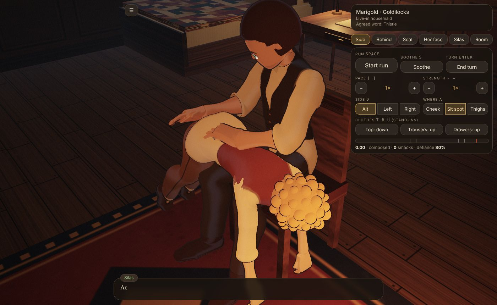

# Fenwick Hall (The Manor in the Woods)

A third-person narrative walking simulator with gated spatial progression, environmental storytelling, discipline scenes, scripted journeys and a post-game domestic simulation. Silas Fenwick inherits a decayed house in the Fenwood, above the village of Redmere, and restores it and the lives of the seven women who come under his roof. The design is in `docs/gdd.md`. It's built on the figures and discipline engine of [Project Meridian](https://github.com/asonichero/meridian). **What's built, what's drafted and what's still open is in `docs/alpha-plan.md`.**

## Run it

```
npm run serve        # http://localhost:8123/ opens the correction test (session.html); /figures.html is the household line-up; /model.html the bodies and clothes
npm test             # the pain model, the scripted correction, conversations, the figures' rig, the cast and their lines, the estate, the guest bedroom
```

No build step and no dependencies: three.js r128 is in `vendor/`. The bodies, clothes and hair are built in Blender and saved as `models/fenwick_{f,m}.glb`, `models/fenwick_hair.glb` and `models/fenwick_meta.json`. To rebuild them you need Blender 5 (the `bpy` module from PyPI works, with numpy and scikit-image) or Blender's own binary with `-b --python`:

```
python3 -m venv .blender && .blender/bin/pip install "bpy==5.1.*" scikit-image
.blender/bin/python tools/blender/build_figures.py -- f m      # the bodies (hers from the measured reference, his derived), their rig and keys, and the clothes (about 5 minutes each)
node tools/export-head.js                                     # the head the game builds in code, for the hair to fit (tools/blender/head.json)
.blender/bin/python tools/blender/build_hair.py                # the hair styles and Silas's beard (seconds)
```

`model.html` shows the bodies and clothes as a turnaround; `figures.html` shows the household, `?who=<id>&view=head-three` for a close look at someone's hair, `?<id>=<outfit>` for another outfit and `?clothes=up,down,down` for the layers raised and lowered.

## Clothes and hair

- **Dresses** for six of the seven: a bodice laced down the front with the chemise showing at the neckline, sleeves to the wrist or the elbow, and a full skirt to the lower calf. Under them are knee-length drawers, stockings and shoes or ankle boots. **Gretel** wears a patched kirtle (the same cut, to above the knee) over darned leggings, with boots. **Red** wears the same for walking the estate, more often as time goes on (`Estate.outfitFor`). Each heroine's colours, apron, print and patches are in `Cast.WARDROBE` and drawn on per pixel. Some have outfits for story moments: Goldie's own clothes, Eleanor's rags, Rapunzel's tower gown.
- **Hair** is built in Blender to fit the code-built head: a scalp shell cut along the hairline, under tapered locks that follow the scalp, fall with gravity, curl into ringlets or coil into a bun. Goldie has curls; Red and Rapunzel have a center part into their plaits; Snow White has a side part and fringe; Belle a chignon; Eleanor a working bun; Gretel a knife-cut crop; Silas short tousled hair and a beard.

## The correction test (`session.html`)

The guest bedroom of Chapter 1, where Silas finds Goldie asleep among half-eaten rations, spilled ink and a broken antique chair.

- **Set-up**: who's corrected, in order (any of the seven), the position (across the knee on the oak chair, across the knee on the edge of the bed, hands on the writing table), the room as found / being restored / restored, Ch. 1's clues out or cleared away, day or night, Silas's look, and each heroine's relationship sliders (submission, desire, comfort, defiance, resentment). URL parameters set the same: `?who=goldie,belle&pos=otk:bed&state=found&clues=1&time=night&terms=1`.
- **Her terms** (optional, first): Silas sets out how his household works. She agrees and chooses her safe word.
- **The correction** plays as Meridian's does: her skirt raised (the hand takes the hem behind her calves), leggings lowered where she wears them, then drawers. Runs on a toggle (**Space**), pace (`[` `]`), strength (`-` `=`), side (**D**), where (**A**), soothe (**S**), the clothes (**T B U**), end turn (**Enter**), cameras (**C**). The meter shows her distress against the bar where she'd call her word. Her responses are in her own voice, by distress band, defiance and temperament.
- **Aftercare** on the settle (or the bed's edge): reassure her, say why it mattered, ask how she is; then what she's to do with the rest of the day. A summary follows.



## Files

| File | What it is |
|---|---|
| `js/cast.js` | Silas, the seven heroines and the village cast: what the GDD states (names, ages, roles, flaws, how each resists) kept apart from drafts (bodies, looks, pain stats, safe words, clothes) |
| `js/lines.js` | Everything said: Silas placing and correcting her; her reactions, defiance and word; the aftercare; her terms |
| `js/estate.js` | The estate as game state: chapters, zones and their gates, restoration and hearths, homes, vignettes, the week, relationship tracks (nothing in one lowers another), post-game habit drift and its clues, the finale's roles, reputation |
| `js/guestroom.js`, `js/kit.js` | The guest bedroom (Ch. 1), as found and restored; the kit rooms are painted from |
| `js/session.js` | The correction, played (ported from Meridian; changed only to take Fenwick's cast, and her period layers: a skirt raised from its hem, only the layers she wears, what each cushions) |
| `js/figure.js`, `js/poses.js` | The figures (Blender-built bodies, clothes and hair, skeleton, skinning, toon shading, faces; the period garments' details and stockings drawn per pixel; a long braid) and posing |
| `tools/blender/build_figures.py`, `tools/blender/build_hair.py`, `tools/export-head.js` | Building the bodies and clothes, and the hair, in Blender |
| `js/pain.js`, `js/discipline.js`, `js/talk.js`, `js/audio.js`, `js/stage.js` | Ported from Meridian: the pain model, the scripted correction, conversations, synthesised sound (plus a hearth ambience), the renderer |
| `session.html`, `figures.html`, `model.html` | The correction test, the household line-up, the models' turnaround |
| `docs/gdd.md`, `docs/The_Manor_in_the_Woods_GDD.docx` | The design document |
| `docs/alpha-plan.md` | The plan: stated, ported, drafted, open |
