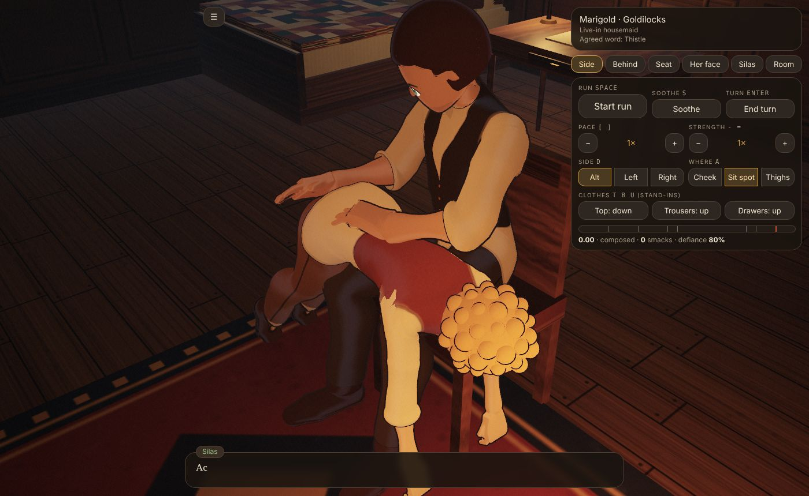

# The Squire of Redmere: Alpha Plan

This plan comes from parsing the Game Design Document (`docs/gdd.md`, converted from `docs/The_Manor_in_the_Woods_GDD.docx`) and from what can be taken from **Project Meridian** (`asonichero/meridian`): its figures and its discipline engine. As Meridian's own plan did, it keeps these apart:

- **Stated**: what the GDD says.
- **Ported**: engine pieces from Meridian, and their state in this repo.
- **Drafted**: first drafts built here where the GDD is silent. Each is marked in the code (`draft`, or "drafted" in a comment) and listed in §5. Nothing drafted contradicts the GDD. Each is easy to change.
- **Open**: questions for the designer (§6). Where I have a suggestion, it's marked *suggestion*.

---

## 1. The game, as the GDD states it

A third-person narrative walking simulator. Silas Fenwick, a practical woodsman, inherits a decayed country house above the village of Redmere and restores it. Seven young women from European fairy tales (all 18 to 21) come under his roof as employees and wards. He brings order to the estate and to their lives. Five pillars:

1. **Third-person spatial exploration** of the Hall, courtyard, woods and village edge, on foot, at a grounded pace. **Progression is gated physically**: doors unlocked, fallen timber cleared and rooms restored open new wings and trigger new arrivals.
2. **Environmental clue-finding** before a confrontation: muddy footprints, broken furniture, wolf tracks, pried locks, hidden food caches.
3. **Intervention and discipline scenes**: a framed dialogue scene where Silas enforces a boundary, teaches a skill or administers firm discipline. **Dialogue choices shape each heroine's growth and change later ambient interactions.**
4. **On-rails and cutscene journeys**: escorting someone through the woods at twilight, touring hazardous ruins, facing a threat at the village border.
5. **Evolving manor state**: from dusty and boarded up to warm and lived in, the women filling particular rooms and forming their own dynamics.

**Structure**: seven chapters, one per heroine, each opening a zone, then a finale at the West Wing (the convergence: Snow White's stepmother with bailiffs challenging the title, and a wolf pack). The finale relies on what each woman has learned. Ambient vignettes run between chapters (four named pairings). **Post-game ("The Steward's Year")**: free roam across seasons; discipline continues as habit maintenance and romantic and domestic push-and-pull; **habit drift** (each resident's hidden Compliance and Mindfulness slide unchecked and bring back clues: unlatched doors, misplaced ledgers, late-night candle glow); **late-night interventions**. **Non-exclusivity**: each relationship runs on its own track, and nothing in one thread lowers another.

### What the alpha needs

| # | System | GDD | State in this repo |
|---|---|---|---|
| 1 | Third-person exploration: a walking character, camera, collision, interactables | Pillar 1 | **Not built.** Meridian has none (it chose rooms as scenes over walking). This is the largest new system. See open question A |
| 2 | Zones, gates and chapter progression | Chapter table | **Built as data** (`js/estate.js`): eight zones, their gates, the chapters and their beats. Gate kinds drafted except the two the GDD states |
| 3 | Clue-finding | Pillar 2 | Each chapter's clues listed (`Estate.CHAPTERS[].clues`). **Ch. 1's are placed** in the guest bedroom (`room.setClues`). How the player finds and reads them is open (B) |
| 4 | Intervention and discipline scenes | Pillar 3 | **Ported and playable** (`js/session.js`, `session.html`), with every line new in each heroine's voice (`js/lines.js`) |
| 5 | Her terms, agreed before any correction | (Meridian's consent model) | **Built**: `Lines.terms(id)`, playable from the test page. Whether she can decline, and what follows, is open (C) |
| 6 | Aftercare | (Meridian) | **Ported**, every line new: reassure / why it mattered / how she is, then what she's to do with the day |
| 7 | Choices shaping growth and ambient interactions | Pillar 3 | Relationship tracks **built** (`Estate.affect`: trust, respect, affection, growth; romance where named). Not yet wired to scenes |
| 8 | On-rails journeys | Pillar 4 | **Not built.** Placed: Ch. 2's twilight escort, Ch. 4's border confrontation. "Touring hazardous ruins" isn't placed (G) |
| 9 | Evolving manor state | Pillar 5 | **Built**: restoration per room, hearths lit, the Hall's warmth (`Estate.restore`, `light`, `warmth`). The guest bedroom renders three states (as found, being restored, restored) |
| 10 | The estate's places | Setting table | **One room built**: the guest bedroom (Ch. 1). Everything else to build |
| 11 | Ambient vignettes | Four pairings | **Built as data** (`Estate.VIGNETTES`, available once both are in residence). Scenes not built |
| 12 | The week: village days, Hall days, boundary walks | Lore | **Drafted** (`Estate.WEEK`, `DAY_SERVES`) |
| 13 | Habit drift and late-night interventions | Post-game | **Built** (`Estate.drift`, `intervene`), with each heroine's GDD lapses and their clues. Rates drafted |
| 14 | The finale | Climax | Roles **as data** (`Estate.FINALE`). Scene not built |
| 15 | The village's verdict, gossip | Ending, lore | Reputation facets **as data** (`Estate.REPUTATION`, `raise`). Gossip not built |
| 16 | Period clothes and hair | Setting | **Built in Blender** (§3): dresses, a kirtle, leggings, drawers, smalls, boots; eight hair styles and Silas's beard. Red's cloak still to build (E) |
| 17 | Saved game, chapter scripts, title screen | — | **Started**: the title (`game.html`) and the first scene script, the prologue's opening in the hall (`js/prologue.js`), played by a cutscene player (`js/cutscene.js`: shots, lines, faces, heads turned, acts). Saved game not built |

---

## 2. What's ported from Meridian

| Meridian | Fenwick | State |
|---|---|---|
| `vendor/` (three.js r128, OrbitControls, post-processing, GLTFLoader, SkeletonUtils) | `vendor/` | Copied as is |
| `models/meridian_{f,m}.glb`, `meridian_meta.json` | `models/fenwick_{f,m}.glb`, `fenwick_meta.json` | Copied, renamed. The non-gendered body (Meridian's AI) is left out |
| `tools/blender/build_figures.py`, `reference.json`, `tools/measure-reference.py` | same | Copied; output names changed to `fenwick_*`. Runs unchanged on Blender 5.1 (its Python module, `bpy`, from PyPI) and reproduces Meridian's bodies exactly. **Added**: her period wardrobe (§3) |
| (none) | `tools/blender/build_hair.py`, `tools/export-head.js` | **New**: the hair, built in Blender to fit the head the game builds in code (§3) |
| `js/figure.js` | `js/figure.js` | Code unchanged but for the model file names, and **one addition**: a long `braid` hairstyle (Red's, Snow White's and Rapunzel's plaits) that hangs with gravity |
| `js/poses.js`, `js/stage.js`, `js/pain.js`, `js/discipline.js`, `js/talk.js` | same | Code unchanged; comments re-themed (the Captain → Silas, deck → floor) |
| `js/session.js` | `js/session.js` | Code unchanged but for the roster hook (`root.Cast`, `Cast.squireSpec`) and her period layers (a skirt raised from its hem, round over her seat; only the layers she's wearing; what each cushions, from the figure); comments re-themed. Internally the corrector is still `captain` and the room `bay`, so it stays diffable against Meridian |
| `js/audio.js` | `js/audio.js` | Ported; **added** a hearth ambience (a fire's crackle, the wind in the Fenwood). The music's themes are still Meridian's |
| `js/crew.js` | `js/cast.js` | **New**: Silas, the seven heroines and the village cast, in the shape the engine reads |
| `js/lines.js` | `js/lines.js` | Same structure; **every line new**; adds `terms(id)` |
| `SuitBay.kit`, `Quarters.kit` | `js/kit.js` | The helpers (canvas textures, merging, which wall a thing is on) kept; the textures are new (limewash, oak panelling and boards, stone, brick, a Turkey rug, linen, a patchwork quilt, dust sheets, leaded windows, cobwebs) |
| `js/capquarters.js` (the Captain's quarters) | `js/guestroom.js` | **New room on the same layout**: the chair, the bed's edge, the writing table, the settle and every camera where the Captain's quarters had them, so the tuned posing carries over. Re-dressed as a period guest bedroom with two states and Ch. 1's clues |
| `session.html` | `session.html` | **New page** keeping Meridian's HUD, controls, dialogue box and aftercare flow; without the AI, bridge, check-in and day machinery |
| `figures.html` | `figures.html` | As Meridian's: a heroine and Silas, outfits, clothes, poses, the relationship sliders, expression, response and views; in the correction's positions, the correction runs on props, looping round after round with the correction test's controls (no dialogue, no meter, no change to the sliders) and a Reset that clears her marks |
| (none) | `household.html` | **New**: the household line-up |
| `model.html` | `model.html` | Ported (the bodies and garments as a turnaround sheet) |
| `tests/` | `tests/` | `pain`, `discipline`, `talk`: unchanged. `figure`: adapted to the cast, plus the braids, the period wardrobe and the hair. **New**: `cast`, `estate`, `room`. `npm test` passes 61 of 61 |

**Not ported**: Meridian's ship rooms, its day loop (`day.js`, `daylines.js`, `deckplan.js`, `visit.js`), its AI (`checkin.js`, `stations.js`, `docs/proctor.md`), and the non-gendered body. Meridian's day loop is the nearest source if Fenwick's week ends up played as rooms-as-scenes (A).

---

## 3. Decisions carried over from Meridian

The brief was to use Meridian as the base for models and discipline mechanics, so these come with it. Each is the designer's to confirm or change.

- **The look**: Meridian's figures. Realistic adult proportions (a slightly larger head), toon shading with ink outlines, painted faces with expressions. Fenwick's rooms are painted in code in the same way.
- **Consent**: each heroine agrees a **safe word**. The player is the disciplinarian, so the stop is the pain model's high, held "too harsh" bar, and **she calls her word herself**. It stops at once and goes straight to her aftercare. Meridian's onboarding rule (taken in hand only after the method is explained and her consent given) becomes Fenwick's **terms** conversation. The GDD doesn't mention consent; see question C.
- **The scene is player-run**: runs of smacks on a toggle, pace, strength, side, where, soothing between; garments raised or lowered on screen; she reacts by temperament, distress band and defiance. Defiance drains into Compliance, or into Resentment if it's forced; aftercare clears half the resentment.
- **Positions**: across the knee (on a chair, or a bed's edge), and over a table (in the guest room, the writing table, her hands holding its far edge). Standing with her hands on a support was dropped.
- **Adults only**: every heroine is 18 to 21, as the GDD states, and a test enforces it. Hansel is never part of a correction.

### Decided since: clothes and hair, built in Blender

- **Period dresses** for all but Gretel (`tools/blender/build_figures.py`, her build). Each dress has a fitted bodice laced down the front, with the chemise showing at a low, round neckline. The sleeves go to the wrist (Belle, Rapunzel, Snow White) or to just below the elbow for work, with the chemise's frill below. The skirt is fitted over the hips and hangs as a bell to the lower calf, fuller behind, with folds. Under it are loose knee-length drawers with a frill, stockings gartered above the knee (drawn on the legs), and shoes or ankle boots. The details (lacing, chemise, apron, sprig print, bands, patches) are drawn per pixel (`js/figure.js`: the `dressG` pattern), so one set of meshes serves every heroine in her own colours (`Cast.WARDROBE`).
- **Leggings** for Gretel: a patched kirtle (the same cut, to just above the knee) over darned leggings and fitted smalls, with boots. **Red** wears leggings as her alternate for walking the estate. On the grounds and in the wood she chooses them about one walk in four when she first comes to the Hall, most walks after a season, and a little more as she trusts Silas. Never in the village, and only now and then indoors (`Estate.outfitFor`; the rates are drafts).
- **The skirt's shape** (`build_figures.py`): it falls from her waist, where an apron ties, taut over her belly, hips and seat the way a hanging cloth is, then hangs nearly straight to the hem with a little flare (no petticoats), in gathers that open into broad folds. It hangs over the outline of what's under it (her drawers, or leggings) smoothed out, so their ruffles don't show through. The armhole seam between bodice and sleeve is drawn per pixel, from the shoulder's point down to the armpit, rather than along the mesh's triangles.
- **Her skirt is live cloth below the waist** (`js/figure.js`: `makeCloth`, `tickCloth`). This replaced the skirts baked in Blender, whose folds came out messy and which clipped at the table.
  - The skirt (or kirtle, chemise or night-dress) is a grid of points: 56 columns round her and 30 rows from the waist to the hem. Its rest shape is the garment as built, sampled from its own points, with soft folds below the hips. So standing, it's the skirt as it was made, and its pattern (print, apron, hem band, patches) is drawn from those rest positions. The garment as built is kept above the waist; below, its triangles are taken out.
  - The top row is held where the bodice ends, skinned as the dress's nearest point is. The rest falls with gravity, position-based: each point keeps its distance from its neighbours across, down and diagonally, and from the next but one. It gives a little more to being pushed together, into folds, than to stretching. Each point is also tethered to the top of its column, so it can't slide round her and off her seat when gravity pulls across her.
  - What it lies on: her body as spheres, measured once for each body and build. Their centres are inside her, each as large as reaches her surface, chosen so together they cover her from below the chest down, not the arms, and each is carried by her bones. Raised, her drawers or leggings are folded into the measure, so the side panels lie over them. Silas's spheres are used when he's near, with an allowance for his clothes, and the furniture is the room's boxes (anything hidden is left out), plus the floor. Cloth touching something holds there: what it's moved across it since the last step is mostly undone, so it doesn't creep or slide into the gap between her legs.
  - Put somewhere new (a pose, raised or let down, moved bodily), it settles at once, behind the cut. She's brought into the pose from standing, her hips where the pose has them and the rest of her eased from rest into place, while the cloth follows. So it ends where it would hang on her and never starts threaded through her legs. Then it settles a little more. After that, a step a frame, damped hard: it follows her as she wriggles without swinging about. It costs a few milliseconds a frame and under a second to settle.
  - Raised, the back is rolled up to the small of her back. Each column within about 60° of the middle of her back is wound, from the row level with the roll down to the hem, round a tube lying across her back just above her seat and a little lower at its ends. It's as thick as the cloth in it, with the hem at its heart, and laid there, carried by her hips, not simulated. The cloth above the roll, and the sides and front, are free and fall from it, pulled up diagonally into its ends by the cloth itself.
  - Nothing under it is hidden: her drawers and her skin are drawn, since the cloth can lift off her anywhere. It's kept 2 cm clear of her body and whatever she wears under it (her drawers or leggings are folded into the spheres).
  - Once she's in place and her legs have been still for half a second, it's frozen. Each free point is anchored where it settled to her bone under it (or her hips, the further it hangs clear), and from then on it's just carried by her bones: no simulation, under a millisecond a frame. If her legs move a quarter of a metre or more relative to her hips (another pose, not a kick or a stamp), it's simulated again until she's still, then frozen anew. While her skirt is down her legs are kept still: only her hips and back turn, so nothing of her can come through it. Raised, she kicks and stamps as before, the frozen skirt carried with her. (This is the idea of Bandinopla's three-simplecloth, blending each point between the simulation and where the skeleton carries it, here all the way to the skeleton once settled.)
  - The strip just below the waist (7 cm) is held where the dress is built, skinned as the dress is, so it runs on from the bodice without a step. Its drawn thickness starts at nothing at the waist.
  - Easing her into a pose takes as many steps as it needs for nothing of her to move more than a centimetre at a time (40 to 180). So when she bends over the table and her legs sweep down through where the skirt hangs, they push it ahead of them instead of passing through it.
  - Nothing passes through it. The middle of each cell, between its four points, is kept out of her as well as the points, so nothing pokes through between them. When she moves quickly (a kick, a buck), the step is cut into as many as it takes for nothing to move more than about 8 mm at a time. Where she and Silas overlap (her belly on his lap, him close at her hip), the cloth caught between them is held where it is, as if pinched, not pushed through one of them. Only his lap and legs count: his clothes have a thicker allowance, and it slides off him freely. Moved bodily between one frame and the next (another stance, another pose), it's placed again and settled rather than dragged.
  - Raised, it's first settled hanging in the pose; then the points of the back are carried from where they hang, out over her and up into the roll, a little at a time, the rest following. So the front hangs in front of her thighs, as a lifted skirt's does. The back lies flat on her from the waist to the roll; the roll is slim (as thick as the cloth wound in it, a couple of centimetres) and every point of it is laid 4 mm off her, measured at its own height round her (her body, or her drawers over it), so there's no gap to see through.
- **In a correction** the layers are her skirt (or kirtle, or night-dress), raised at the back and rolled at the small of her back, the sides and front left hanging. A chemise is shirt-length and isn't raised by hand: it rides up of itself at the table, and across the knee it goes up when her drawers come down. The scene goes through black as it's raised or lowered. Then her leggings, if she wears them, lowered to her knees. Then her drawers (or smalls), lowered. A skirt that's down cushions most. The drawers aren't drawn under a skirt that's down (they show below a kirtle or a chemise). Across the knee Silas's other hand rests across the small of her back, just above the roll: the wrist just past her spine, the fingers bent at the knuckles over her far side, the elbow out toward him, his shoulder a little up (placed in the pose editor). It's the same whatever she has on, raised or down, and rests on what she's wearing there, measured from the garment: a bodice lies close, a chemise a little off her, a loose nightdress well off. With her back bare there (nothing on, or a chemise gone up above it) it sits nearer him, the first fingers laid flatter across her. When he pins her wrist there, it closes over it. Some brace themselves rather than reach back (Belle, Eleanor and Gretel: `braces` in `js/cast.js`): when her distress is high and she has given in, her near hand grips the side of the chair by his hip and her far hand his shin below the knee, sliding a little toward her feet to reach (from the pose editor). Braced, she doesn't reach back to cover herself, so his hand never has to pin hers. Goldie, Red, Rapunzel and Snow White would rather be held. At the table's edge his hand holds the roll in place at her near hip. Over the table Silas stands at her left as placed in the pose editor: turned almost square to her side, a step toward her legs, his hips up and tipped forward, his torso twisted toward her; his left hand flat across the small of her back. As his hand comes down he turns and leans into it, as she comes up off the table he straightens, and for her thighs, out of reach from there, he bends lower only as far as he needs to. She lies as placed in the pose editor: bent less at the hips, her back curving down to the top, her head up and round to face along it, her feet a little nearer the table, her elbows out and back, level with it. Defiant, her chest and head come up off the top; given in, her chest bends down onto the top and her head goes down and round, away from Silas (the pose editor's, at full submission). Across the knee her elbows bend toward her head, a little toward her far side, clear of his leg. Every dress keeps a few millimetres clear of her arms, so the skirt and sleeves never run together. Its skirt is drawn in over the last few centimetres to the bodice at the waist seam, as if gathered there, and the cloth starts at the bodice's edge, so there's no ledge where they meet, and no line is drawn along the join.
- **At the table** her legs are straight and her feet planted a fixed distance from it. Hands on its edge, her stance is set once, as she'd stand at her most upright, and kept; bent further, the slack is in her elbows. Looking back over her shoulder moves only her upper body. Over the table Silas turns in toward it, so his near foot is outside its leg. Across the knee he sits in the middle of the chair (or the bed's edge); a room whose seat is a bench says how far along it he sits. Across the knee on a bed, her near arm rests on whatever's under it, the quilt tidy or rucked, found by looking down onto the bed.
- **Her body's detail** (`build_figures.py`, `js/figure.js`). Most of it is painted from rest-pose positions, as the clothes' details are, so it stays sharp and moves with the skin. On her chest: areolae and nipples, with a slight rise to each in the model, shaded below and lit above. A crease under each breast that sits lower on a fuller bust and is fainter on a smaller one, and a shadow between them. Collarbones and the notch at the throat. A navel, a hollow in the model, deepest under its hood. A faint line down the belly and the lines of the hip bones. On her back: the spine's groove, the edges of the shoulder blades, the dimples above the seat. Kneecaps. Silas has the same, his own way: smaller, browner nipples set on his pectorals (modelled with a slight rise, as hers are), the pectoral's lower edge in place of the crease under a breast, his navel, a faint line down the middle of his belly and two across it above the navel, the outer edges of the belly's muscle, the hip lines a little longer and deeper; the collarbones, spine, shoulder blades (to his broader shoulders), kneecaps, feet and toenails as hers; and fine dark hair over his breastbone and under his pectorals, a trail below the navel, and a little on his forearms and shins.
- **Her ankles and feet** are drawn rather than measured, because the turnaround's ankle is a straight column. The lower leg narrows above the ankle. The Achilles tendon stands out behind, with a hollow either side. The ankle bones show, the inner one higher and further forward. The leg closes inside the foot, so there's no ring where they join. Between 17 and 29 cm up, the measured calf eases into the drawn leg, including the lobe that carries the calf's bulge behind. The calf tapers into the ankle instead of stopping at a line. The foot has a heel, an instep that's highest on the big toe's side, an arch lifted on the inner edge, the ball, and five toes, the big toe a little apart. Its faces are subdivided after the body is drawn and put back on the surface, so the toes come through at the body's resolution. Toenails, the shadows between the toes, and a paler sole are painted. Boots are built round a smooth last, not the toes.
- **Wrists**: the forearm tapers from its fullest, a few centimetres below the elbow, to the wrist, its lower quarter slender and even, the wrist the narrowest of it (as measured, it had swelled toward the wrist, the hand caught in its outline). The hand keeps its original palm (a rounded box), but over its first 6 cm, most of the back of the hand, it's blended from the wrist's own section: as wide, as deep, as round as the wrist where it leaves the arm. The forearm runs on past the wrist only at the wrist's own size, and the hand joins it closely. So the wrist no longer swells before the hand, and the hand doesn't start as a ledge wider than the wrist. (A first attempt lofted the whole palm from the wrist, which changed the hand's shape and looked worse.)
- **The pose editor** (`poses.html`, the figures page with `?edit=1`), after fairy-shoe's: the correction frozen at a moment (the pose, her clothes, his right hand as it goes, raised or on her), a dot on each joint of her or Silas, dragged to reshape the figure (the hips move all of it; a hand or foot is placed by two-bone IK and its limb follows; any other joint turns the bone above it; with hands pinned, both stay where they are), or set exactly in degrees (and, for the hips, the figure's place and turn). Edits are kept per moment while the page is open. **Copy report** gives each joint changed: its local rotation (XYZ, as the posing code sets it) and what it was, its place in the room and from the other figure's hips, and each figure moved. A preview only: what's kept is built into the posing (the `TUNE` table in `js/session.js`, or the posing itself) from the report, placed relative to her so it fits each heroine. The first editor's sliders kept their settings in the browser; what mattered of them is in the code now, and the page clears the rest.
- **Silas has one build**, average: the lean and heavy options are gone.
- **Outfits for moments in the story**: Goldie's own clothes (as found); Eleanor's rags (as found), and for her days off a soft blue sprigged dress Silas buys her in place of them; Rapunzel's outgrown tower gown or her garden dress. The test page offers them.
- **The maid's uniform**, Goldie's and Eleanor's alike: a russet work dress with elbow sleeves, a clean apron, a cream chemise, drawers, grey stockings, each in her own shoes (`Cast.MAID`).
- **The prologue's cast** (`js/cast.js`; docs/gdd.md, "Prologue: The True Bride"), listed apart from the seven (`Cast.PROLOGUE`, chapter 0). Cicely, the false bride (20): a chestnut chignon; in Adela's gown, then (Silas has her take it off, since it was never hers) her own linen shift and drawers, made as the night-dresses are, which she's corrected in; then the goose girl's plain dress. Adela's gown is a great house's, finer than anything the main game's women wear: a gown (`kind: 'gown'`, its own Blender-built garment, to the floor and fuller, falling deeper behind), finely made (`fine`): sapphire silk damask (an ogee lattice tone on tone, a flower in each cell), an ivory stomacher with gold ribbons in place of the lacing, a deep gold-embroidered border at the hem, wide embroidered cuffs with lace below, lace at the neck with a row of pearls, ivory silk shoes. She's the prologue's correction: defiant and proud, her own lines throughout, and her terms are the confrontation in Silas's office, where he gives her the word himself, the mare's name, Falada. Adela, the true bride (19): a long fair plait from a side parting, in the goose girl's patched brown dress and canvas apron (her own gown when it's given back); never corrected, so she has no lines of her own (the lines fall back to a few plain words for anyone without them). The master of Thornleigh (61, grey-haired and bearded, stouter) and his son (25, clean-shaven), on Silas's body at their own heights and builds (`Cast.manSpec`), in evening clothes: a waistcoat over a long-sleeved white shirt, a cravat, dark trousers and boots, claret and green. Kit is spoken of, not built. `household.html?set=prologue` lines them up with Silas; the figures page lists Cicely and Adela.
- **Thornleigh's great hall** (`js/hall.js`; the prologue's opening scene). 9 m by 14 m, stone walls over an oak wainscot, a flagged floor, an open timber roof on tie beams; evening. A long refectory table down the middle on a red rug, a linen cloth on it and the feast finished: their three used places (pewter plates with scraps, goblets, crumpled napkins), a carved roast on a charger, a half loaf, a bowl of fruit, flagons, two candelabra burning low. The master's high-backed carved chair at its head (north), the house's arms on a tapestry behind it (azure, a chevron between three hawthorn sprigs: *Fidelis*), candle stands either side; his son at his right and Cicely beside him (the west side), a great stone hearth in the west wall behind them, its fire lit; only the three of them have places at it. Across from them, Silas's mark, where he stands before them. At the master's left (east) a round-headed archway onto a stone passage running along the hall, lit by a torch, its far end dark: Adela's way in, her mark in the archway. A court cupboard of pewter at the head, the great doors at the foot with a bench by them, tall round-headed windows dark with the evening. The furniture and the two marks are laid out by `Hall.ROOM`; the walls, hearth, archway and passage stay. `rooms.html` is the room editor (after redlessons' and consequence's), with views of the hall (from the foot, a corner, above, the archway, the passage, the hearth, behind his chair, over Silas's shoulder) and the scene's cast in their places.
- **The prologue's opening scene, played** (`game.html`, `js/prologue.js`, `js/cutscene.js`, `js/player.js`). The game opens on its title, The Squire of Redmere, over the opening shot held still and dimmed. Two cards follow over the same still: Thornleigh, some years before Redmere; then, in the second person, that the player manages Thornleigh's lands and people for its master, trusted for their judgement, the final say their master's. That card asks the player's name, first and surname, with Silas Fenwick filled in. It's kept in the browser; the scenes call the player by their first name, and the surname will name the hall they inherit. Then the false bride's sentence, as a cutscene, in the GDD's order:
  - Cicely playing the entitled lady: the venison, and a cook turned off without a character at her father's table. The master's irony.
  - The goose girl called in to pour, coming through the archway, and Cicely's scorn of her ("she was always slow").
  - The steward's business at table, and the master flattering her into judging it.
  - At his nod, Silas's case from a neighbouring estate, told as a trade quarrel: a farrier, his apprentice, the letter and the good coat, the stables, the old mare sold at the first fair.
  - Cicely's sentence: stripped, thrashed, turned out with nothing, as her father would deal with it.
  - "Then you have named your own sentence." The master translates the case to her face, piece by piece, down to the gown she's wearing and the mare's name, Falada, then names them both: a surprise to both women (and the iron stove, with Silas beyond the wall).
  - Her plea to Young Thornleigh, turned to him with her hand on his arm. He rises and answers her ("You were never my bride"), crosses to Adela, apologises, and on his second line goes down on one knee and takes her hand.
  - The decree (his office), Silas's bow, and black.

  About fifty beats, around two minutes at reading pace. Thornleigh and Young Thornleigh are named so; until the reveal the two women are shown as The Bride and the goose girl. One pose eases into the next (her turn to him, his rising, his kneel); heads turn a moment after a new speaker, each their own, and drift a little. Young Thornleigh's eyes are scripted: his plate while she finds fault, his father, Silas through the case, Adela once she's named, and Cicely not once till her plea. The shots and the points looked at are set from each person's place, so they follow the hall's layout as it's edited. Faces include a haughty one for Cicely (the brows up, the lids heavy, a small closed smile, the chin lifted). *Drafts*: every line beyond the GDD's beats; the cards; the shots. Then the office (below), and the correction.
- **Silas's office at Thornleigh** (`js/office.js`; the confrontation, and the correction and aftercare to come). The estate office off the yard, 5 m by 4.8 m: limewashed walls over a dark skirting, a boarded floor, a beamed ceiling. His desk out from the north wall (an open ledger, a stack of shut ones, papers, the inkstand and quill, a candlestick burning), his chair behind it (plain, sturdy, armless: the correction's), shelves of ledgers and tied papers behind him, the estate's map on the wall; a small fire in the west wall with a chair by it; a window onto the dark yard in the east, its shutters folded back; a strongbox; the door in the south wall, which opens and shuts (`office.door`), a board of keys and his coat on a peg beside it. Laid out by `Office.ROOM` like the hall (`rooms.html?room=office`), with marks for where Cicely stands before the desk, where Silas shuts the door, and where he stands before her; the way round the desk's east end is taken from the desk as it stands.
- **The confrontation, played** (`Prologue.SCENES.office`, after the hall in `game.html`). He shuts the door and goes round to his desk while she pleads, lightly ("a story told at supper"; let her go quietly tonight). **The prologue's one choice**: how he answers her, firm, dry or gentle, each a line of his and her answer; kept (`fenwick:prologue`, `tone`) to set how defiant she is when the correction starts. Then his questions, one at a time (what she took; why that mare; how long Adela kept the geese, and where she slept; how long she'd have let it go on), till she says what she did in her own words and concedes: she named the sentence, and he must do as he's bid. He gets up and comes round the desk to her, and relents: he'll not thrash her, as she put it, but she'll learn her lesson, at his hand and in measure, if she wants the house to give her a character when she leaves it. Then the word, the mare's name, Falada, hers to say; she accepts; and the gown, first, which was never hers. She reaches for its lacing, and black; the correction is next (to be built). About forty beats. The cutscene player gained walks along a way of spots, sitting, standing, the door, her hands to her lacing, lines said while someone moves, and choices. *Drafts*: every line beyond the GDD's beats; the shots.
- **Walking** (`js/gait.js`; `tools/blender/export_anims.py` → `models/walk.json`). The Mixamo clips (Standard Walk, Start Walking, Stop Walking: `models/*.fbx`) retargeted onto our skeleton: each bone's turn in the world from their T-pose, laid on ours after turning ours to point as theirs do at rest (the arms up level); the hips' rise, fall and sway in proportion to our legs; their going forward carries the figure along its way, so the feet stay put. A walk is planned before it's begun: the start where there's room, the walk, and the stop (mirrored to follow on from either foot), coming out at the length asked to the millimetre (steps lengthened by at most 12%, usually under 1%); short walks begin in the walk, or the stop. Turns at the way's corners; eased in from standing and out into the pose that follows. Adela walks a little slower. Used by every walk in the cutscenes.
- **The prologue's correction, played** (`Prologue.SCENES.correction`, `js/tutorial.js`, after the confrontation in `game.html`). Across his knee on his chair, pulled out from the desk into the office (its mark; `office.setChair`), Cicely in her own shift and drawers; the correction engine (`js/session.js`) as the test page plays it, given the office as its room (`office.bay()`) and the tutorial as its **director**: a new, small hook in the engine (`opts.director`: what she may do of her own accord, what waits for the player, how low her defiance may go yet; `ses.putBack`, `handDown`, `pushUp`, `cover`, `breakNow`). Without one, the engine behaves as before. The phases, as the GDD has them: **before you begin** (she's not down: put her back; raise her shift; a run); **defiance** (back-talk, looks back, she pushes up and waits to be put back; pace and strength taught); **covering** (her hand back over her seat: told the first time, the wrist pinned the second); **pride** (her drawers lowered; she holds in what she feels: read the meter, which is lit); **breaking** (her defiance let go: the sob, "I was wrong. I was wicked to her."; slow the pace, soothe); **acceptance** (what she did and why, in her own words: envy, twenty years behind her mistress; then end it, which waits for this). It can't be failed. Her word ends it whenever she says it, and the end card says so (without the offer). How he answered her plea sets her defiance coming to it (dry 0.9, firm 0.78, gentle 0.66). The prompt panel at the top lights the control it asks for; the controls along the foot, the meter under them; the lines go on by themselves. Played through in the browser by a player doing as asked: every phase in order to the next card. Next: the aftercare and the offer.
- **Nightclothes**, barefoot. Goldie, Red and Eleanor, whose elbow sleeves show a white chemise below them, sleep in that chemise and their drawers. Gretel sleeps in a rough one of unbleached linen, patched, and her smalls. The chemises are shirt-length, a little longer at most, so the drawers or smalls show below. Rapunzel, Snow White and Belle wear a linen night-dress to the ankle, like Rapunzel's tower gown, raised as a skirt is. All of it is undyed linen, as Silas's are, Gretel's rougher, darker and more worn. The chemise is a shift built in Blender, loose from the bust and shoulder blades, gathered at the neck, no lacing. The night-dress has no lacing either, but its body follows her to the waist as a dress's does, a little easier, its skirt the cloth from there (hung loose from her bust, it held its standing shape lying down and stood off her back). Silas sleeps in a nightshirt and linen drawers, undyed: his day shirt (the same body, open neck and rolled sleeves, his forearms bare) with its hem to just above the knee. The chemises and his nightshirt are built as his day shirt is, not as skirts: fitted to the torso with ease, joined to the sleeves round the armhole, hanging straight from the hips to the hem, the body carved back from the sleeves where the arms hang beside it (as a dress's is) so a long tail never swallows them; raised, a mesh of their own with the hem rolled above the waist. A night-dress's sleeves go to the wrist and stay on when its skirt is taken off for its cloth. His trousers have a lower crotch and a modest pouch at the front, weighted to his pelvis: a suggestion, nothing more. The figures page offers him dressed, in his nightclothes, or with nothing on.
- **Hair** (`tools/blender/build_hair.py`): each style is a mesh fitted to the code-built head (exported by `tools/export-head.js`). It's a scalp shell cut exactly along the style's hairline, under locks: tapered strands that follow the scalp and fall with gravity, coil into a bun or hang as ringlets. They're darker at the roots, coloured per point and multiplied into the hair's own colour, so each style serves any colour. The styles: Goldie's curls over the whole head, with rows of ringlets down the back; Red's and Rapunzel's hair swept back from a center part into the plait; Snow White's side part with a swept fringe; Belle's chignon, set against the back of her head with its outer turn bedded in the locks that lead into it, and a curled tendril at each ear; Eleanor's working bun, coming loose; Gretel's knife-cut crop; Silas's short tousled hair and a full beard. Where locks gather into a bun or a plait, they taper to fine ends rather than stopping square. The plaits themselves are built in code (`js/figure.js`: `braidOf`). Each is rounded over at the top where the locks gather, its strands cross in lobes down to the tie, and it ends in a short brush. It's skinned to a chain of bones that falls with gravity (verlet, damped). The top two bones are held to the head; below them each is drawn gently toward going straight on from the one above, so it bends along its length. The chain is kept out of the head, out of her back (an ellipse across each trunk bone) and off the floor. It settles at once when first seen or after a cut. Its end is heavier: the joints down it are slower to take up a swing and quicker to lose it, each drawn a little toward hanging plumb below the one above, so it hangs straight rather than flicking about.
- **Necks and raised arms** (`js/figure.js`: `adopt`). The back of the neck is drawn all the way up into the skull, whose lower part goes with the head. Blender's weights spread the upper arm's hold across the chest and upper back nearly to the middle, so a raised arm used to haul the ribcage up and out. Now the arm holds only itself and the cap of the shoulder, taking over from the ribcage within a centimetre or two at the armpit's crease. Its points in the armpit are blended straight across between ribcage and arm rather than turned round the shoulder, which leaves a hollow instead of a wing, and the outline is finer there. This applies to the body and every garment alike.

---

## 4. The first playable (`session.html`)

The guest bedroom, Chapter 1. Choose who is corrected and in what order (any of the seven), the position (across the knee on the oak chair, across the knee on the bed's edge, hands on the writing table), the room's state (as found, being restored, restored), whether Ch. 1's clues are out, day or night, and whether her **terms** are played first. Silas's look and each heroine's relationship sliders are in the set-up. Then it plays as Meridian's correction test does, through her aftercare to a summary. `figures.html` shows the household line-up.

Checked in headless Chromium: the page loads with no errors; a correction runs to the end and the aftercare plays through; Belle's terms play before her correction; Rapunzel calls "Larkspur" when it goes too far, and it stops.

---

## 5. Drafted here, for review

- **`js/cast.js`**: each heroine's body (height, build), look (skin, hair and style, eyes), how she takes pain, her wilfulness, and her resistance as two numbers (*overt*, open defiance; *covert*, concealment, withholding). These come from the GDD's "Resistance" paragraphs: Goldie is the most overt, Gretel the most covert, and Rapunzel and Snow White are "low on both counts". Also her safe word, her wardrobe's cut and colours (`Cast.WARDROBE`), and where she lives. Silas's age (37) and look. What Silas calls Red ("Red") and Snow White ("Snow"). How each heroine addresses him: the maids say "sir"; Red, Belle, Rapunzel and Snow White say "Silas". Hansel's place (village cast, no correction).
- **`js/lines.js`**: every line. That covers Silas placing and correcting her, her reactions as her distress rises, her defiance and how it breaks, her word, the aftercare, and the terms.
- **`js/estate.js`**: the gate kind for each zone, except the briars (Ch. 6) and the West Wing, which the GDD states. Also: the upper rooms opening in Ch. 3; each chapter's beats and further clues; the week's order and whom each day serves; the drift rates and thresholds; the tracks' starting values; the reputation facets.
- **`js/guestroom.js`**: the room's layout and furnishing (a half-tester bed, a writing table, a settle under the window, a fireplace, a clothes press, a washstand, the broken gilt chair).
- **Looks**: the heroines' designs come from the tales, never from any film's version. Snow White wears a plait, not a bob, with Grimm's colouring. Belle wears green, not yellow. Rapunzel has golden hair, blue-grey eyes and no purple. Cinderella wears ash-grey and russet, not blue.

---

## 6. Open questions

### A. Exploration and camera
1. The GDD says third-person, on foot. Meridian chose rooms as scenes instead (a map, then each room is a scene). Is free walking needed for the alpha, or could the first chapters be played room by room while the walking prototype is built? *Suggestion*: build Ch. 1 as room scenes first (everything else is ready for it), and the walking prototype alongside.
2. Locomotion: retargeted mocap (as Little Red's Lessons did with Mixamo clips: `motion.js`, `mocap.js`), or procedural walking on the current rig?
3. Camera: over the shoulder, or fixed cinematic angles per room?
4. How much of the estate is in the alpha, and how big? The Hall, the grounds, the Fenwood and the village edge are a large art job.
5. Platform: still a browser game (three.js, no build step), desktop only or phones too?

### B. Scope and clues
6. Which chapters are in the alpha? *Suggestion*: Ch. 1 end to end, then Ch. 2. Between them they touch every pillar: the Hall, a clue trail, discovery, terms, a correction, aftercare, restoration, the forest, a journey and the village.
7. Is the post-game in the alpha at all?
8. How clues are found and read: highlighted on approach, examined in close-up, or noted in a journal? Must they all be found before the confrontation?

### C. Consent and the terms
9. Keep Meridian's safe words? (Built: each heroine chooses hers in the terms.)
10. Can she decline the terms, and what follows? The GDD says Goldie "returns only if she is willing".
11. The GDD has Silas discipline Goldie for the trespass *before* he offers her the post. The draft makes that first correction her choice: the reeve, or Silas. Is that right? How does each heroine's first correction come about?

### D. The correction scenes
12. Positions for each room, and which rooms have them (the study's desk, the kitchen table, the laundry's copper?).
13. Implements: the GDD says nothing. Meridian keeps the hand only, with implements unlocked through the story. Any in Fenwick (a hairbrush, a strap, a switch from the wood)?
14. Is the scene player-run, as Meridian's is? Does the infraction set how severe it is?
15. Witnesses. The ensemble chapters pair heroines (Ch. 4 Goldie with Cinderella, Ch. 7 Belle with Snow White) and the roommates vignette has Silas "hold Goldilocks accountable". Are corrections ever in front of the others? Meridian: private early in the story, public later.
16. Meridian models the body's response and lets desire be present. Fenwick's named romance tracks are Red and Belle, and the post-game's late-night vignettes are "intimate". For whom, and from when, is desire part of a scene? (Built: the desire slider is open for all; romance tracks only for Red and Belle until the designer opens others, `Estate.allowRomance`.)

### E. Clothes
17. Still to build: Red's hooded cloak (outdoors; a maid's cap; petticoats under the skirts?). The skirts are skinned to the legs, not simulated, so a strong kick bends the skirt with the leg. Is cloth simulation wanted later?
18. What changes during a correction: built as skirt raised, then leggings lowered, then drawers lowered. Is that the order wanted? Are the colours and cuts in `Cast.WARDROBE` right?

### F. Cast
19. What Silas calls Red (Red or Rose?) and Snow White. How each addresses him (sir, Silas, Squire?).
20. Hansel's age, and whether he's seen.
21. Silas: a fixed look (the GDD's Silas), or customisable? The test page lets you change his skin, hair and build. His voice?
22. The kinship rumour (the GDD leaves it open): local colour, the reason Silas reads the wood so well, or dropped?

### G. Systems and numbers
23. The gate for each zone (drafted except the briars and the West Wing).
24. What moves each track (trust, respect, affection, growth)? Does growth decide the finale (what if a heroine hasn't learned her skill)?
25. Habit drift's rates and thresholds; how often clues appear; the "tone" choice of a late-night intervention (authority, dry humour, affection).
26. The week's order. Does the week run before the post-game?
27. Reputation: how gossip moves it, and whether it gates anything.
28. "Touring hazardous ruins": which chapter? (Candidates: Ch. 3's West Wing landing, Ch. 6's gatehouse.)

### H. Look and sound
29. The grade is warmer than Meridian's steel. Is that right?
30. Music: Meridian's themes are still in. Pastoral themes for the Hall, the wood and the village?

---

## 7. Milestones (*suggestion*)

1. **Engine, cast and first room** (this branch): the port, the cast, the lines, the estate model, the guest bedroom, the correction test.
2. **Chapter 1, end to end, as room scenes**: the entrance hall and the stair, the guest bedroom as found, its clues, finding Goldie, her terms, the correction, aftercare, the offer (and her visit home), restoring the room (`Estate` carrying it).
3. **The walking prototype**, if third-person is confirmed: Silas on foot through the Hall, interactables, the camera.
4. **The period wardrobe** in Blender.
5. **Chapter 2**: the cleared drive, the forest trail, the wolf, the twilight escort, Redmere's edge and the bakery.
6. **The saved game and the week.**
